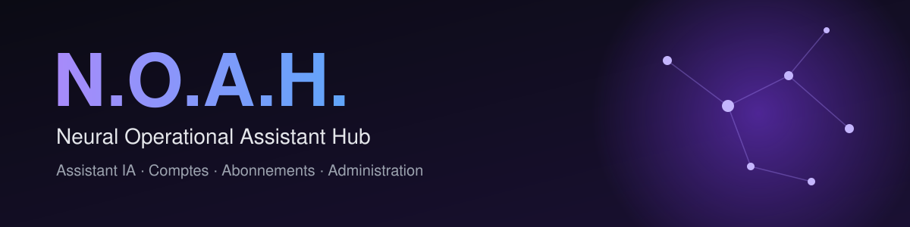
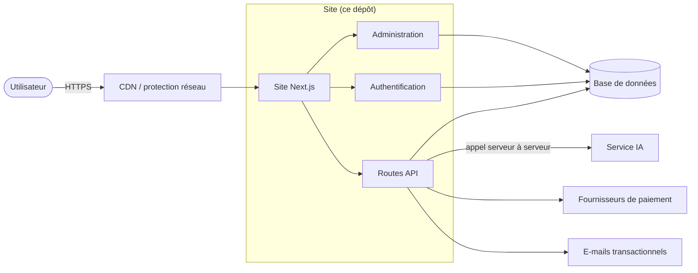
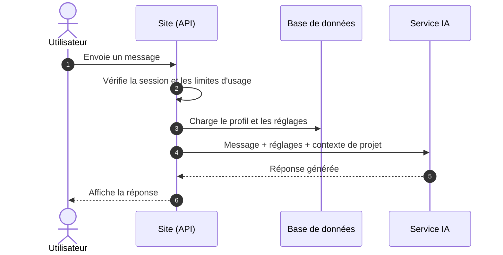
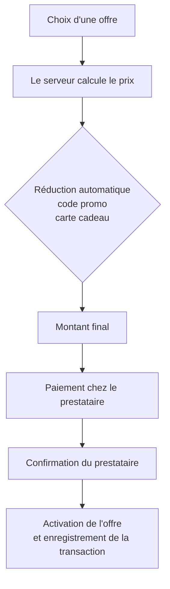

<p align="center">
  
</p>

<p align="center">
  
  
  
  
  
  
  
</p>

<p align="center">
  <b>Le site de N.O.A.H.</b> : un assistant IA francophone avec comptes, personnalisation, abonnements et espace d'administration.
  <br>🌐 <a href="https://noah-ia.fr">noah-ia.fr</a>
</p>

---

## Sommaire

- [Présentation](#présentation)
- [Aperçu](#aperçu)
- [Fonctionnalités](#fonctionnalités)
- [Architecture](#architecture)
- [Stack technique](#stack-technique)
- [Parcours détaillés](#parcours-détaillés)
- [Structure du projet](#structure-du-projet)
- [Installation en local](#installation-en-local)
- [Qualité et bonnes pratiques](#qualité-et-bonnes-pratiques)
- [Feuille de route](#feuille-de-route)
- [Contribuer](#contribuer)
- [Licence](#licence)

---

## Présentation

**N.O.A.H.** (*Neural Operational Assistant Hub*) est un assistant d'intelligence artificielle conçu pour le français. Ce dépôt contient le **site web** : l'interface de discussion, la gestion des comptes, la boutique d'abonnements et le panneau d'administration.

Le moteur de l'IA est un **service indépendant** : le site s'occupe de l'utilisateur, de ses réglages et de ses abonnements, puis délègue la génération des réponses à ce service.

## Aperçu

> Les captures d'écran seront ajoutées dans `docs/screenshots/`.

| Chat | Personnalisation | Offres |
|:--:|:--:|:--:|
| *(capture à venir)* | *(capture à venir)* | *(capture à venir)* |

| Paiement | Projets | Administration |
|:--:|:--:|:--:|
| *(capture à venir)* | *(capture à venir)* | *(capture à venir)* |

## Fonctionnalités

### 💬 Assistant IA
- Discussion en temps réel avec historique et plusieurs conversations.
- **Projets** : regrouper des conversations et partager un contexte commun.
- **Personnalisation** poussée : ton (amical, professionnel, mentor, technique, humoristique…), niveau de formalité, créativité, humour, format et longueur des réponses, langue, instructions personnelles.
- **Mémoire** activable ou désactivable par l'utilisateur.
- Choix du modèle selon l'abonnement.
- Statistiques d'usage personnelles.

### 👤 Comptes et communauté
- Inscription / connexion par e-mail ou via Discord.
- Profil, avatar, badges honorifiques et système de **parrainage**.
- Programme **étudiant** avec vérification.
- Suppression de compte avec effacement des données associées.

### 💳 Boutique
- Offres **classiques**, **étudiantes** et **entreprises**, entièrement gérées depuis l'administration (prix, avantages, couleurs, cycle mensuel/annuel).
- Paiement par carte et par PayPal.
- **Réductions** automatiques ciblant tout le site, une catégorie ou une offre précise.
- **Codes promo** et **cartes cadeaux** utilisables au paiement.
- Facturation mensuelle ou annuelle.

### 🛠️ Administration
- Tableau de bord, gestion des utilisateurs, des rôles et des sanctions.
- Modération : signalements, historique d'actions.
- Gestion de la boutique : produits, réductions, cartes cadeaux.
- Réglages du site et **mode maintenance**.

## Architecture



### Cheminement d'un message dans le chat



### Cheminement d'un paiement



## Stack technique

| Couche | Technologies |
|---|---|
| **Front-end** | Next.js (App Router), React, TypeScript, Tailwind CSS |
| **Back-end du site** | Routes API et Server Actions Next.js |
| **Données** | Prisma ORM, base MariaDB / MySQL |
| **Authentification** | next-auth |
| **Paiement** | Stripe, PayPal |
| **E-mail** | Resend |
| **Intégrations** | Discord |

## Parcours détaillés

<details>
<summary><b>Personnalisation de l'IA</b></summary>

Chaque utilisateur règle le comportement de l'assistant depuis ses paramètres :

| Réglage | Exemples de valeurs |
|---|---|
| Ton | amical, professionnel, concis, créatif, mentor, technique, coach… |
| Formalité | très décontracté → très formel |
| Créativité / humour | curseurs |
| Format | paragraphes, puces, listes numérotées, mixte |
| Longueur | courte, moyenne, longue, très détaillée, illimitée |
| Langue | français, anglais, espagnol, allemand… |
| Instructions | texte libre pour décrire ce que l'IA doit savoir ou comment répondre |

Ces réglages sont enregistrés sur le compte et appliqués à chaque conversation.
</details>

<details>
<summary><b>Offres, réductions et cartes cadeaux</b></summary>

- Les offres sont des données (et non du code) : on peut en créer, modifier ou désactiver sans redéployer.
- Une réduction peut cibler **tout le site**, une **catégorie** ou des **offres précises** ; toute offre ajoutée plus tard à une catégorie ciblée en bénéficie automatiquement.
- Le prix final est toujours calculé côté serveur.
</details>

<details>
<summary><b>Parrainage</b></summary>

Chaque utilisateur dispose d'un lien personnel à partager. Le code est mémorisé à l'arrivée du visiteur puis rattaché à son inscription.
</details>

## Installation en local

**Prérequis** : Node.js (version LTS récente), npm, et une base MariaDB / MySQL accessible.

```bash
# 1. Récupérer le code
git clone <url-du-depot>
cd <dossier>

# 2. Installer les dépendances
npm install

# 3. Configurer l'environnement
cp .env.example .env
#    puis renseigner les valeurs dans .env (jamais commité)

# 4. Générer le client Prisma
npx prisma generate

# 5. Lancer en développement
npm run dev
```

Le site est alors disponible sur <http://localhost:3000>.

### Scripts utiles

| Commande | Action |
|---|---|
| `npm run dev` | Serveur de développement |
| `npm run build` | Build de production |
| `npm run start` | Lance le build de production |
| `npm run lint` | Vérification du code |

> 🔒 Le fichier `.env` contient des secrets : il est ignoré par Git et ne doit jamais être publié. Le fichier `.env.example` ne contient que des noms de variables.

## Qualité et bonnes pratiques

- **TypeScript** strict pour limiter les erreurs.
- Validation des entrées côté serveur.
- Montants et droits d'accès toujours décidés par le serveur, jamais par le navigateur.
- Séparation nette entre le site et le service d'IA.
- Rôles et permissions pour l'espace d'administration.

## Feuille de route

- [x] Chat avec projets et personnalisation
- [x] Offres classiques, étudiantes et entreprises gérées en base
- [x] Réductions, codes promo et cartes cadeaux
- [x] Panneau d'administration
- [ ] Captures d'écran et documentation utilisateur
- [ ] Tests automatisés
- [ ] Pages d'administration complémentaires (contenu, support)

## Contribuer

Les contributions externes ne sont pas ouvertes pour le moment. Pour signaler un bug ou une idée, ouvre une *issue*.

> 🛡️ **Sécurité** : si tu penses avoir trouvé une faille, merci de **ne pas la publier** dans une issue publique et de contacter directement l'équipe.

## Licence

Projet propriétaire — tous droits réservés. Le code est visible à titre de consultation uniquement ; toute reproduction ou réutilisation nécessite une autorisation écrite.

---

<p align="center">Fait avec ❤️ par l'équipe N.O.A.H.</p>
